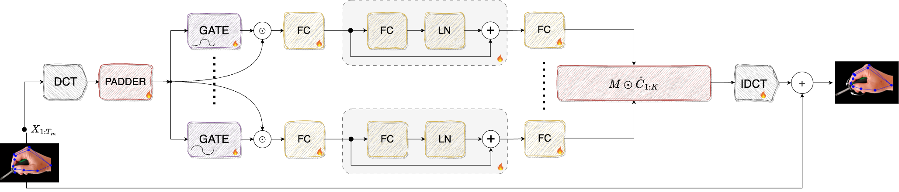

# SFgDNet: Slow–Fast Gated DCT for 3D Hand Motion Forecasting

This repository hosts the codebase accompanying the unpublished CVPR 2026 submission titled *“SFgDNet: A Lightweight Architecture for 3D Hand Motion Forecasting via Slow–Fast Gated DCT Modeling”*. The focus is on reproducing the SFgDNet training/evaluation workflows described in the paper and on providing the utilities used to analyze and visualize the resulting predictions.



## Repository overview

- `SFgDNet/`: primary Python package that implements SFgDNet backbones, dataset handling, and training loops.
- `SFgDNet/out/`: default output directory for checkpoints, CSV logs, and exported prediction/target tensors.
- `SFgDNet/run_*.sh`: convenience scripts to start common experiments (ablations, best-model retraining, cross-action evaluations).
- `SFgDNet/visual_and_tables/`: scripts that aggregate CSV summaries and render comparative figures for the ablation study.
## Setup

1. Create and activate a Python 3.11 virtual environment, then install dependencies with `uv`:
   ```bash
   uv install
   ```
   This project relies on `uv` to manage reproducible environments; `uv install` reads the local manifest and installs the pinned packages into the active interpreter.
2. Prepare the 4D Hands datasets and point the experiments to it via `--data-dir`. The default metadata files under `SFgDNet/data.py` and `SFgDNet/datasets.py` describe expected folder layouts and preprocessing variations.
3. Ensure `SFgDNet/out/` is writeable — it stores checkpoints, CSV logs, and evaluation tensors for every workflow.

## Workflows

### Ablation study: `SFgDNet/ablation_study.py`

Sweeps combinations of window/horizon sizes, hidden dimensions, and architectural knobs to reproduce the slow/fast branch ablations from the paper. Both `SFgDNet` and the new `sfgdnet_try` variant can be selected independently.

```bash
python SFgDNet/ablation_study.py --data-dir /path/to/assembly --dataset assembly --models SFgDNet,sfgdnet_try,mpt --hidden-sizes 32,64 --epochs 50
```

Key notes:

- `--save-root` defaults to `SFgDNet/out/ablation/<dataset>` and it also controls where per-run CSV files land.
- `--save-eval-examples` persists prediction/target tensors under `SFgDNet/out/ablation/...` for later plotting.
- Customize grids via `--preset`, `--hidden-sizes`, `--gru-layers`, `--lrs`, `--use-space`, and other flags described inside `SFgDNet/ablation_study.py`.
- The slow/fast gating and learnable DCT hyperparameters can be toggled via `--SFgDNet-*` flags to match the configurations from the tables in the paper.

### Retrain best configs: `SFgDNet/train_best_models.py`

Retrains the highest-performing configurations identified during the ablations.

```bash
python SFgDNet/train_best_models.py --model SFgDNet --dataset assembly --data-dir /path/to/assembly --save-root SFgDNet/out/best_runs/checkpoints
```

- Reads `SFgDNet/out/best_runs/<dataset>/best_models.json` by default; override with `--best-json`.
- Logs metrics to `SFgDNet/out/best_runs/results.csv` (and appended suffixes for windows/horizons).
- Supports `--save-SFgDNet-mask`/`--save-SFgDNet-gates` and `--save-sfgdnet-try-mask`/`--save-sfgdnet-try-gates` for the gating analysis from the paper.
- Use `--log-wandb`/`--wandb-*` flags for optional Weights & Biases logging.

### Cross-action evaluation: `SFgDNet/train_cross_action_models.py`

Holds out one action and evaluates transfer from the remaining actions.

```bash
python SFgDNet/train_cross_action_models.py --actions attempt,remove,pick --test-action remove --samples-per-action 600 --data-dir /path/to/assembly
```

- Writes CSV logs to `SFgDNet/out/best_runs/results_cross_action.csv`.
- Sampling reproducibility is controlled by `--seed` and `--samples-per-action`.
- Override the swept windows/horizons with `--window`/`--horizon` when targeting specific points from the paper.
- Each row records the withheld action via the `withheld_action` column.

## Visualization & summary scripts

- `SFgDNet/visual_and_tables/generate_experiment_summaries.py`: aggregates the best-run CSVs into a single table for table reproduction.
- `SFgDNet/load_SFgDNet.py` / `SFgDNet/load_sfgdnet_try.py`: inspect checkpoints for each variant and plot gate/mask statistics.
- `SFgDNet/visual_and_tables/generate_ablation_summaries.py`: merges ablation results across datasets and extracts metrics needed for the slow/fast gating ablation table.
- `SFgDNet/visual_and_tables/comparison_plot.py`: renders the model comparisons shown in the appendix (loads tensors stored under `SFgDNet/examples/` and saves figures to `SFgDNet/visual_and_tables/`).

Run them after training to regenerate the tables and figures for manuscript updates.

## Tips

1. When adding new datasets, update `SFgDNet/datasets.py` with action metadata and window/horizon defaults.
2. Start with `--preset basic` or `--max-runs` to get quick feedback before scaling up the ablation grid.
3. Use the `SFgDNet/run_*.sh` wrappers to launch multi-run experiments consistently (`SFgDNet/run_ablation.sh`, `SFgDNet/run_cross_action_experiments.sh`, etc.).

## Reproducing the paper figures

1. Run the ablation sweeps with `--save-eval-examples`.
2. Retrain the best configurations via `train_best_models.py` and collect the gating mask artifacts.
3. Execute `SFgDNet/visual_and_tables/comparison_plot.py` using the saved tensors and store figures under `SFgDNet/visual_and_tables/`.

These steps mirror the order in the CVPR 2026 submission’s evaluation pipeline.
